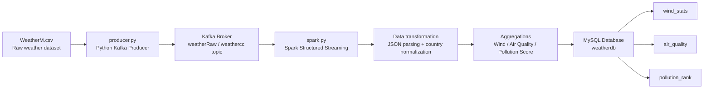
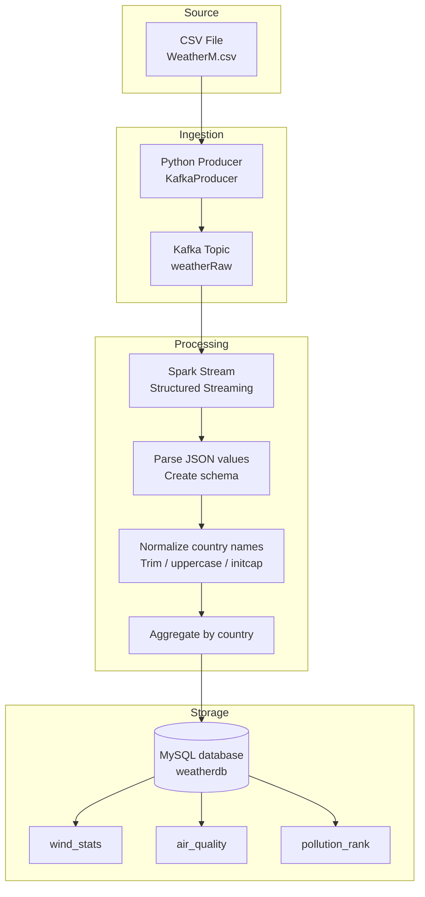
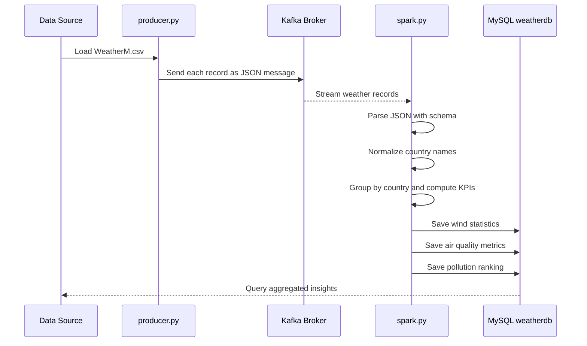

# Big Data Weather Analytics Pipeline

A streaming big-data project that ingests weather records from a CSV file, publishes them to Kafka, processes the live stream with Apache Spark, and stores summarized analytical results in MySQL for reporting and ranking.

This repository demonstrates a practical end-to-end data pipeline using:

- Python
- Kafka
- Apache Spark
- MySQL
- Structured streaming for real-time aggregation

## Project Goal

The project analyzes weather and air-quality data by country and produces aggregated insight tables for:

- Wind statistics
- Air quality metrics
- Pollution ranking

The data pipeline transforms raw weather observations into usable analytical outputs that can support monitoring, comparison, and decision-making.

## Business Use Case

The project is designed for climate and environmental analytics. It helps answer questions like:

- Which countries experience the strongest winds?
- Which countries have the worst air quality?
- Which regions are most impacted by pollution?
- How do daily weather conditions evolve over time?

## Architecture Overview



## Detailed Architecture



## Project Workflow



## Data Flow

1. Raw weather data is loaded from the CSV file.
2. Each row is converted into a JSON record.
3. The producer pushes records into a Kafka topic.
4. Spark reads the Kafka stream in real time.
5. Data is parsed using a predefined schema.
6. Country values are cleaned and standardized.
7. Aggregations are computed for each country.
8. Final tables are written to MySQL.

## Main Components

### 1. Data Producer
File: `producer.py`

This script:

- reads `WeatherM.csv`
- converts records to Python dictionaries
- sends them to Kafka using a `KafkaProducer`
- flushes the messages in batches

Key configuration:

```python
producer = KafkaProducer(
    bootstrap_servers="localhost:9092",
    value_serializer=lambda v: json.dumps(v).encode("utf-8")
)
```

### 2. Streaming Processor
File: `spark.py`

This script:

- creates a Spark session
- reads data from Kafka topic `weathercc`
- parses the JSON payload into a structured schema
- waits for a data batch window
- aggregates by country
- writes the results to MySQL

It computes three main analytical outputs:

- `wind_stats`
- `air_quality`
- `pollution_rank`

### 3. Database Schema
File: `queries.txt`

Creates the database and tables used by the pipeline:

- `weatherdb.wind_stats`
- `weatherdb.air_quality`
- `weatherdb.pollution_rank`

Example schema:

```sql
CREATE TABLE weatherdb.wind_stats (
    id INT AUTO_INCREMENT PRIMARY KEY,
    Country VARCHAR(100),
    avg_wind_kph DOUBLE,
    max_wind_kph DOUBLE,
    min_wind_kph DOUBLE,
    avg_gust_kph DOUBLE,
    created_at TIMESTAMP DEFAULT CURRENT_TIMESTAMP
);
```

## Aggregation Logic

The Spark job calculates:

### Wind analysis
- Average wind speed
- Maximum wind speed
- Minimum wind speed
- Average gust speed

### Air quality analysis
- Average PM10
- Average O3
- Average NO2
- Average SO2
- Average CO

### Pollution rank
A pollution score is calculated using weighted metrics:

```python
pollution_score =
    avg_PM10 * 0.40 +
    avg_NO2 * 0.25 +
    avg_O3 * 0.15 +
    avg_SO2 * 0.10 +
    avg_CO * 0.10
```

This score is then ordered in descending order to rank countries by pollution severity.

## Tech Stack

- Python 3.x
- Pandas
- Kafka Producer API
- Apache Spark Structured Streaming
- Kafka Connector for Spark
- MySQL
- Java runtime for Spark and JDBC support
- JDBC driver for MySQL

## Repository Structure

```text
Big_Data/
├── README.md
├── producer.py
├── spark.py
├── queries.txt
├── WeatherM.csv
├── kafka-clients-3.9.1.jar
├── spark-sql-kafka-0-10_2.13-4.0.1.jar
├── spark-streaming-kafka-0-10-assembly_2.13-4.0.1.jar
├── mysql-connector-j-8.3.0.jar
├── mssql-jdbc-12.6.1.jre11.jar
├── commons-pool2-2.12.1.jar
├── .gitattributes
└── ...
```

## Environment Requirements

Before running the pipeline, make sure the following are available:

- Java JDK 11+
- Apache Kafka
- Apache Spark
- MySQL Server
- Python dependencies

Install required Python packages:

```bash
pip install pandas kafka-python pyspark
```

## Setup Instructions

### 1. Start MySQL
Create the database and user specified in `queries.txt`:

```sql
CREATE DATABASE weatherdb CHARACTER SET utf8mb4 COLLATE utf8mb4_general_ci;
CREATE USER 'seif' IDENTIFIED BY '123';
GRANT ALL PRIVILEGES ON weatherdb.* TO 'seif';
FLUSH PRIVILEGES;
```

Then create the tables:

```sql
CREATE TABLE weatherdb.wind_stats (
    id INT AUTO_INCREMENT PRIMARY KEY,
    Country VARCHAR(100),
    avg_wind_kph DOUBLE,
    max_wind_kph DOUBLE,
    min_wind_kph DOUBLE,
    avg_gust_kph DOUBLE,
    created_at TIMESTAMP DEFAULT CURRENT_TIMESTAMP
);

CREATE TABLE weatherdb.air_quality (
    id INT AUTO_INCREMENT PRIMARY KEY,
    Country VARCHAR(100),
    avg_PM10 DOUBLE,
    avg_O3 DOUBLE,
    avg_NO2 DOUBLE,
    avg_SO2 DOUBLE,
    avg_CO DOUBLE,
    created_at TIMESTAMP DEFAULT CURRENT_TIMESTAMP
);

CREATE TABLE weatherdb.pollution_rank (
    id INT AUTO_INCREMENT PRIMARY KEY,
    Country VARCHAR(100),
    pollution_score DOUBLE,
    avg_PM10 DOUBLE,
    avg_NO2 DOUBLE,
    avg_O3 DOUBLE,
    avg_SO2 DOUBLE,
    avg_CO DOUBLE,
    created_at TIMESTAMP DEFAULT CURRENT_TIMESTAMP
);
```

### 2. Start Kafka
Launch Zookeeper and Kafka in your local environment.

Example:

```bash
bin/zookeeper-server-start.sh config/zookeeper.properties
bin/kafka-server-start.sh config/server.properties
```

Create the Kafka topic if needed:

```bash
bin/kafka-topics.sh --create --topic weatherRaw --bootstrap-server localhost:9092 --partitions 1 --replication-factor 1
```

### 3. Run the Producer

```bash
python producer.py
```

This will read the CSV file and send records to Kafka.

### 4. Run the Spark Streaming Job

```bash
python spark.py
```

The Spark job listens for Kafka messages, aggregates the latest batch, and writes to MySQL.

### 5. Query the Results

```sql
SELECT * FROM weatherdb.wind_stats;
SELECT * FROM weatherdb.air_quality;
SELECT * FROM weatherdb.pollution_rank;
```

## Example Data Model

The incoming weather records contain fields such as:

- `Country`
- `location_name`
- `temperature_celsius`
- `condition_text`
- `wind_kph`
- `gust_kph`
- `pressure_mb`
- `humidity`
- `cloud`
- `visibility_km`
- `air_quality_Carbon_Monoxide`
- `air_quality_Ozone`
- `air_quality_Nitrogen_dioxide`
- `Air_Quality_Sulphur_Dioxide`
- `air_quality_PM10`

## Notes and Observations

- The project is a classic streaming pipeline pattern: ingest → process → analyze → store.
- The producer sends one weather record per Kafka message.
- The Spark job waits for a short inactivity period before processing a batch, allowing grouped analysis.
- The MySQL tables are overwritten each cycle, which makes the database act like a fresh report snapshot.
- The project is useful as a teaching example for real-time analytics and streaming pipelines.

## Potential Improvements

- Add topic partitioning and scalability improvements
- Use Kafka consumer groups properly
- Add a dashboard (Power BI, Grafana, Streamlit, or Flask)
- Store raw events in a data lake or warehouse
- Add timestamps and event IDs for historical analysis
- Introduce automated scheduling and monitoring tools

## Summary

This project demonstrates how to build a scalable weather analytics pipeline using modern big-data technologies. It collects raw environmental data, streams it through Kafka, analyzes it with Apache Spark, and stores aggregated insights in MySQL. The result is a practical real-time processing system that turns raw weather observations into meaningful business intelligence.

## License

This project is provided for educational and demonstration purposes.

---

If you want, I can also create a more polished version of this README for GitHub with:

- a landing page style banner
- screenshots/diagram assets
- installation steps tailored for Windows/Linux/macOS
- a section for troubleshooting common Kafka and Spark issues
- a sample dashboard design for the analytics output
